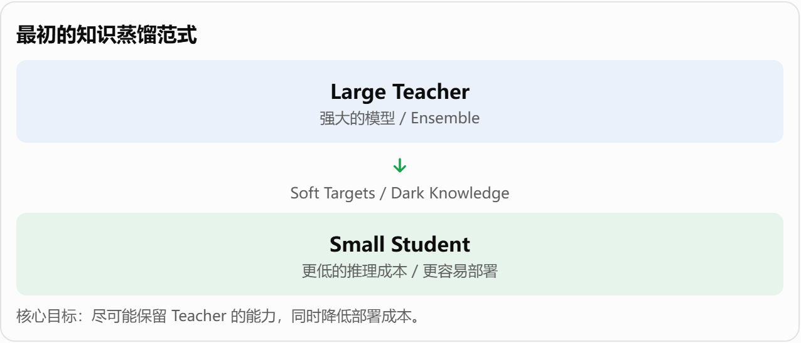
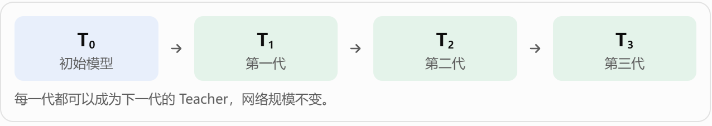
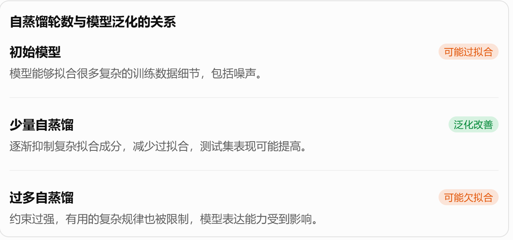
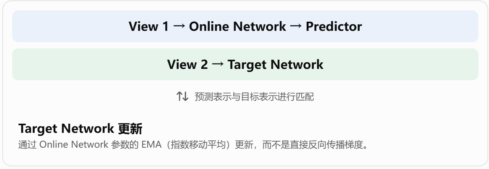
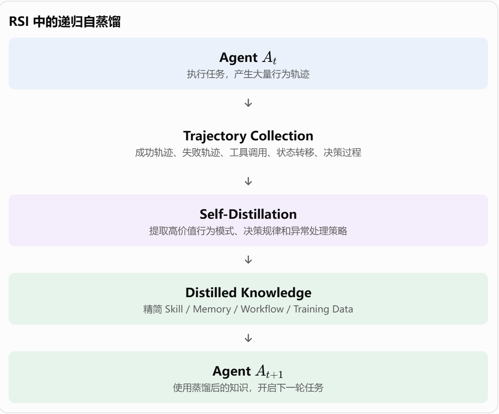

> 知识蒸馏最初是为了解决**模型部署**问题: 如何让小模型学会大模型的能力? 后来研究者发现,即使**Teacher和Student一样大**,甚至**Student的结构,参数量都完全相同**,蒸馏依然可能提升模型性能
> 
> 

**知识蒸馏带来的收益,到底来自Teacher提供了额外的知识,还是来自蒸馏这种训练方式本身**


## 模型压缩

[**Hinton：Distilling the Knowledge in a Neural Network**](https://arxiv.org/abs/1503.02531)

### **为什么大模型的预测结果比普通标签更有信息?**

假设有一张猫的图片。

普通监督学习中,标签是:

```Plain Text
猫: 1
狗: 0
狐狸: 0
汽车: 0
```

这是hard label,只告诉模型正确答案是什么

但是,一个训练好的teacher可能给出

```Plain Text
猫: 0.90
狗: 0.07
狐狸: 0.02
汽车: 0.01
```

这是soft label

区别在于:

- Hard label: 只告诉你猫是正确答案

- Soft label: 还告诉你猫与狗之间存在一定相似性,而猫与汽车之间的相似性很低

这些正确答案以外的概率分布,能够传递类别之间的相对关系\.

Hinton将其中有价值的信息称为 **Dark Knowledge**


### 为什么需要蒸馏?

假设Teacher是一个非常大的模型,推理准确率很高,但推理成本也很高

希望训练一个小模型Student, 让他不仅学习真实标签,还学习Teacher输出的概率分布

一个典型的蒸馏损失可以写成:

$L = \alpha L_{CE}(y,p_s) + (1-\alpha)T^2 D_{KL}(p_t^T||p_s^T)$

其中:

- $y$: 真实标签

- $p_s$: Student的预测

- $p_t$: Teacher的预测

- $T$: Temperature

- $D_{KL}:$KL散度

温度系数尤其重要: 当T\>1时,Softmax输出会更加平滑,原本接近0的类别概率会变得更容易观察,从而暴露更多类别间的相对关系



**蒸馏不是简单地把Teacher的预测结果当成新标签,而是让Student学习Teacher输出的概率结构**


## Student为什么可以超过Teacher

[A Gift from Knowledge Distillation](https://openaccess.thecvf.com/content_cvpr_2017/papers/Yim_A_Gift_From_CVPR_2017_paper.pdf)

这篇工作有一个重要观察: **知识蒸馏带来的收益,并不只是让小模型逼近大模型**

它发现,通过**网络中间层**传递知识,Student不仅可以更快地优化,而且在某些实验中能超过一个同等规模,直接从头训练的模型

这里有两个值得区分的收益:

1. **优化收益**: Student更容易训练,收敛速度可能更快

2. **泛化收益**: Student最终在测试集上的表现可能更好

特别有意思的是: Teacher甚至可以来自另一个任务,迁移过来的知识有时仍然有效

这说明Teacher提供的信息**可能不完全等同于**当前任务的正确标签

例如:

- Teacher的中间层可能学到了边缘,纹理,形状等特征

- 这些特征即使来自另一个任务,也可能对当前任务有帮助

- Student因此获得了更好的初始化方向或者优化约束

这篇论文让researcher开始思考:

**蒸馏是不是不仅仅在传递知识,还在改变student的学习过程**


## Teacher和Student一样大,甚至Student更强

[Born Again Neural Networks](https://arxiv.org/abs/1805.04770)

传统蒸馏的逻辑是: $Teacher_{large}-> Student_{small}$

而这篇论文**让Teacher和Student使用完全相同的网络结构和参数规模**

具体流程是:

1. 随机初始化一个网络,正常训练,得到Teacher

2. 再随机初始化一个结构相同的网络,作为Student

3. Teacher冻结,Student使用Teacher的预测作为软标签进行训练

4. 比较二者在测试集上的表现

结果发现: 在多个视觉和语言建模任务中,Student居然能够超过Teacher

这就很反直觉了\.

因为Student并没有更大的模型容量,也没有获得额外的训练数据

甚至Teacher和Student使用的是相同的网络结构

那为什么Student还能更强?

先区分两个概念:

- 模型容量: 网络结构和参数量决定的表达能力上限

- 模型实际表现: 模型经过具体训练过程后,最终学到了什么

**相同的模型容量,并不意味着相同的训练结果**

Teacher和Student的参数初始化不同,训练目标不同,优化轨迹也不同

Teacher是通过真实标签训练出来的,而Student除了真实标签,还学习了Teacher的软输出分布

因此,Student有可能找到一个泛化能力更好的参数解

**更有意思的是: 让Student接着教下一代**

论文进一步研究了迭代蒸馏:



发现,性能并不会无限增长

随着迭代次数增加,收益可能趋于饱和,甚至出现性能回落

这就是self\-distillation的典型形式


[Be Your Own Teacher](https://arxiv.org/abs/1905.08094) 这篇论文和 [Born Again Neural Networks](https://arxiv.org/abs/1805.04770) 有一个重要区别

[Born Again Neural Networks](https://arxiv.org/abs/1805.04770)：

- 先训练一个完整的 Teacher。

- 再重新初始化一个 Student。

- 通过 Teacher 的输出训练 Student。

- 两个网络是独立的。

而[Be Your Own Teacher](https://arxiv.org/abs/1905.08094)更进一步:

**我直接连独立的Teacher都不要了,直接让一个网络内部不同深度的部分互相指导**

假设有一个CNN网络:

```Plain Text
Input
  |
Layer 1
  |
Layer 2
  |-------- Auxiliary Classifier 1
  |
Layer 3
  |
Layer 4
  |-------- Auxiliary Classifier 2
  |
Layer 5
  |
Layer 6
  |-------- Final Classifier
```

作者在网络不同深度设置辅助分类器

训练时:

1. 最深层的分类分支具有更强的特征表达能力

2. 将最深层的分支的预测结果和特征作为指导信号

3. 较浅层分支不仅学习真实标签,还学习深层分支提供的信息

4. 整个网络联合训练

这就形成了: $Deep\  Bracnh-> Shallow\ Branch$

网络内部的知识迁移

实验结果也很有意思;

- CIFAR\-100上平均提升2\.65个百分点

- 不同网络架构上的提升范围为0\.61\-4\.07个百分点

- 还支持不同深度的推理,在资源有限的设备上可以灵活选择推理深度


到这里，知识蒸馏已经出现了三种形态：

1. 大模型教小模型。

2. 同规模模型教新一代同规模模型。

3. 一个网络内部不同深度互相指导。

但还有一个问题没有解决：

**为什么一个模型自己产生的预测，能够帮助它的下一代变得更好？**

毕竟,Teacher并没有获得任何新的真实标签


## Teacher到底提供了什么

**Dark Knowledge with Permuted Predictions（DKPP）** \-\- 这实际上是[Born Again Neural Networks](https://arxiv.org/abs/1805.04770) 论文中的一组消融实验

先看一个例子\.

假设Teacher输出: 

```Plain Text
猫: 0.90
狗: 0.07
狐狸: 0.02
汽车: 0.01
```

正常蒸馏时,Student学习完整概率分布

那么,如果把非最高概率类别的概率随机打乱,会怎么样

```Plain Text
猫: 0.90 -> 0.90
狗: 0.07 -> 0.01
狐狸: 0.02 -> 0.07
汽车: 0.01 -> 0.02
```

- 最高概率类别没有变化。

- 最高概率数值没有变化。

- 所有概率值都保留了。

- 但是非最高类别与其概率之间的对应关系被破坏了。

这就是Dark Knowledge with Permuted Predictions。

**为什么要这样做?**

本质上是在做一个信息消融实验

正常蒸馏: $类别身份+概率大小+类别间关系$

DKPP: $最高类别+置信度+剩余概率值$

二者的区别在于: Student能否知道Teacher认为哪些非目标类别更接近正确答案

结果发现,即使使用DKPP,Student仍然可以超过Teacher,但通常不如完整蒸馏

这说明了两件事:

**第一,完整的类别的间关系确实有价值**

例如，猫和狗的相似性比猫和汽车的相似性更高，这种关系能够帮助 Student 学习。

**第二,类别间关系不能解释全部的蒸馏收益**

因为 DKPP 已经破坏了这部分关系，Student 仍然能够从蒸馏中获益。

那么，剩余的收益可能来自哪里？

- Teacher 对正确类别的置信度。

- 概率分布整体的形态。

- 软目标相较于硬标签带来的训练约束。

- 由此产生的优化和正则化效应。

注意，这里是实验能够支持的解释方向，并不意味着 DKPP 已经严格证明了某一个具体机制。


[**Self\-Distillation Amplifies Regularization in Hilbert Space**](https://arxiv.org/abs/2002.05715)

这篇论文非常关键，因为它开始从理论上解释：**为什么没有新信息输入,自蒸馏仍然可能提升泛化能力?**

先理解一个基础概念: 过拟合

模型可能学到了两类东西：

- 真正有用的规律：能够推广到新样本。

- 训练集中的偶然噪声：只能帮助模型记住训练样本。

我们希望模型更多学习第一种，减少第二种。

这就是正则化想解决的问题

**论文的核心发现:**

作者构建了一个可以进行数学分析的函数拟合框架:

- 模型被表示为 Hilbert 空间中的函数。

- 使用 $L_2$ 正则化。

- 研究模型反复进行自蒸馏时，函数空间中的变化。

他们发现:

**自蒸馏会逐步增强正则化效果,限制模型可以使用的函数基底数量**

可以用一个简化的直觉理解：

假设模型拟合函数由很多不同复杂度的成分组成:

$f(x)=\sum_{i=1}^{n}a_i\phi_i(x)$

其中:

- $\phi_i(x)$: 不同的基函数

- $a_i$: 每个基函数对应的系数

其中一些成分可能对应主要规律，另一些可能对应复杂的局部变化和噪声。

反复自蒸馏，会逐渐限制可用于表示最终函数的基函数。

因此:



这也就解释了为什么[Born Again Neural Networks](https://arxiv.org/abs/1805.04770) 中,模型迭代几轮后收益会趋于饱和,甚至下降

不过有一个重要的学术边界:

这篇论文证明的是其特定 Hilbert 空间函数拟合模型中的正则化机制，不能直接推导为所有深度神经网络的自蒸馏都遵循完全相同的数学规律。

它的贡献是提供了一个具体、可分析的理论解释，而不是给出自蒸馏的统一理论。


## Teacher\-Student的思想已经超出传统知识蒸馏

[Bootstrap Your Own Latent](https://arxiv.org/abs/2006.07733)

BYOL核心目标是: **不依赖人工标签，也不依赖负样本，让模型从同一张图片的不同增强视图中学习一致的特征表示。**

例如，一张猫的图片：

- View 1：随机裁剪、颜色变化。

- View 2：另一种随机裁剪、颜色变化。

两个视图来自同一张图片。

BYOL 使用两个网络：

- Online Network：负责学习和预测。

- Target Network：负责提供目标表示。



为什么这样不会发生两个网络全部输出相同常数的表示？

BYOL 通过 Online Network 中的 Predictor、Target Network 的延迟 EMA 更新，以及非对称训练结构来避免表示坍塌

这里 Teacher 并不是传统意义上先训练好的大模型，而是一个持续变化、通过 EMA 更新的目标网络。


[Emerging Properties in Self\-Supervised Vision Transformers \(DINO\)](https://arxiv.org/abs/2104.14294)

DINO 的 Teacher\-Student 机制与 BYOL 有相似之处。

它同样不需要人工分类标签。

训练时：

1. 对一张图片生成多个不同的视图。

2. Student 接收多个视图。

3. Teacher 接收部分视图，尤其是全局视图。

4. Student 学习匹配 Teacher 输出的概率分布。

5. Teacher 使用 Student 参数的 EMA 更新。

它有一个非常有意思的发现：

经过 DINO 自监督训练的 Vision Transformer，能够自然产生一些有语义意义的注意力图。

例如，模型可以在没有人工分割标签的情况下，逐渐学会关注图片中的物体区域。

这说明 Teacher\-Student 的训练机制可以帮助模型学习视觉结构，而不仅仅是压缩一个已有分类器。


[iBOT: Image BERT Pre\-Training with Online Tokenizer](https://arxiv.org/abs/2111.07832)

DINO 主要关注全局视觉表示。

iBOT 则进一步研究局部 Patch 表示。

例如，一张图片被切成：

```Plain Text
[Patch 1] [Patch 2] [Patch 3]
[Patch 4] [Patch 5] [Patch 6]
[Patch 7] [Patch 8] [Patch 9]
```

随机遮挡部分 Patch。

Student 需要学习：

- 全局层面的图像表示。

- 局部 Patch 层面的特征表示。

Teacher 提供对应的目标分布，Student 学习恢复被遮挡区域所蕴含的语义信息。

因此，iBOT 可以理解为将 Teacher\-Student 蒸馏扩展到了局部视觉 Token 层面。


[data2vec: A General Framework for Self\-supervised Learning in Speech, Vision and Language](https://arxiv.org/abs/2202.03555)

传统蒸馏通常让 Student 匹配 Teacher 的输出概率。

data2vec 则让 Student 预测 Teacher 的上下文隐藏表示（Contextualized Representations）。

也就是说：

- Teacher 提供更高层次的隐藏特征。

- Student 从部分遮挡的输入中学习预测这些特征。

- 不再局限于分类概率分布。

而且这一套框架可以应用于语音、图像和文本。


[DINOv2](https://arxiv.org/abs/2304.07193) 和 [SigLIP 2](https://arxiv.org/abs/2502.14786)

这里需要特别强调：

- DINOv2 与 DINO、iBOT 的自监督视觉学习路线联系比较紧密。

- SigLIP 2 则主要属于视觉语言预训练路线，使用改进的 Sigmoid 图文对比学习目标，并结合多种训练目标。

- 不是简单意义上的自蒸馏模型。


## 总结

- 为什么没有新增信息，Student 还能变好？

    Student 并不是简单复制 Teacher，而是在不同训练目标、参数初始化和优化路径下重新学习

    **信息没有增加，不代表模型的学习过程没有改变**

- 知识蒸馏最初被看作一种知识传递技术，后来逐渐被发现也是一种训练策略。

    也就是说**蒸馏的价值不一定完全来自 Teacher 知道多少，还可能来自 Teacher 以什么方式指导 Student 学习。**


## 将知识蒸馏引入RSI

**Agent 能不能把自己过去成功的行为蒸馏成一种更简洁、更稳定、可迁移的知识，再让下一代 Agent 学习？**

### 让上一代Agent教下一代Agent

[Born Again Neural Networks](https://arxiv.org/abs/1805.04770) 中每一代网络都可以成为下一代的Teacher

迁移到Agent，同样的思路

假设我们有一个专门处理复杂网页操作的 Agent。

第一代 Agent：

- 能够完成 60% 的任务。

- 会搜索页面、填写表单、处理异常。

- 执行轨迹中包含大量尝试、错误和重复操作。

经过一轮改进，第二代 Agent 达到了 70%。

传统 RSI 的做法可能是：

直接把第二代 Agent 的 Skill、Memory 或 Harness 修改结果保存下来，继续使用。

但蒸馏的视角会多问一步：

**第二代 Agent 究竟学到了什么？这些经验中哪些值得传给下一代？**

例如，第二代 Agent 在 100 次任务中积累了：

蒸馏器可以从这些轨迹中提取稳定规律，形成新的 Skill。



普通 RSI 更关注如何根据失败修改自己；自蒸馏式 RSI 则进一步关注如何**从大量行为中提取值得保留的知识**。

二者可以互相结合,而不是互相替代


### Teacher不一定是另一个模型,也可以是自己的历史版本

在 RSI 中，我们可以让 Teacher 和 Student 是同一个模型的不同时间版本,

甚至可以采用更特殊的方式。

**怎样构造一个比当前 Student 更有指导价值，同时又不会与 Student 差异过大的 Teacher？**

外部 Teacher 可能很强，但输出风格和能力分布差异很大，Student 不一定容易学习。

自身历史版本更容易匹配，但又未必足够强。

[RISE](https://arxiv.org/abs/2609.05295) 正是在尝试解决这一矛盾。


### 蒸馏不一定需要完整复制Teacher

回到 Born Again Neural Networks 的 DKPP 实验。

它发现，即使破坏非最高概率类别的对应关系，Student 依然可以从蒸馏中获益。

那么在 Agent 中，我们是不是也不需要完整复制 Teacher 的所有行为？

假设 Teacher 执行一个任务：

```Markdown
1. 打开目标网站
2. 检查登录状态
3. 搜索目标商品
4. 筛选价格区间
5. 打开商品详情
6. 确认库存
7. 加入购物车
8. 提交订单
```

这是一条完整轨迹。

但如果我们只希望 Student 学会其中的通用决策规律，那么可以只蒸馏：

- 什么条件下需要检查登录状态。

- 如何判断页面是否加载完成。

- 什么情况下需要重新检索元素。

- 什么时候应该停止操作。

- 哪些异常需要重试，哪些不应该重试。

这样就不是复制一条轨迹，而是提取轨迹背后的策略。

这很像 DKPP 给我们的启发：需要研究 Teacher 提供的不同信息究竟有多大价值。

在 RSI 中，可以设计消融实验：

**Agent 的自我改进究竟应该保存经历，还是保存从经历中提炼出来的规律？**


